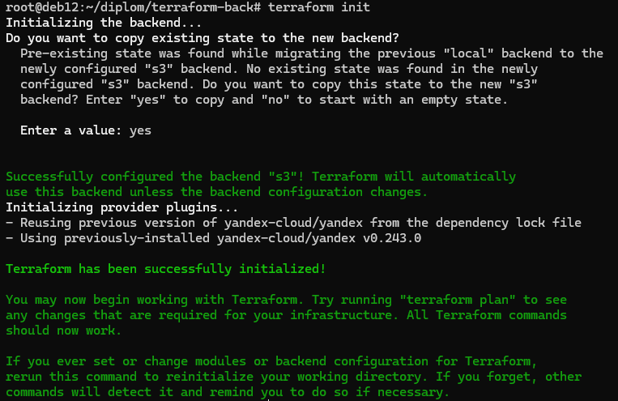
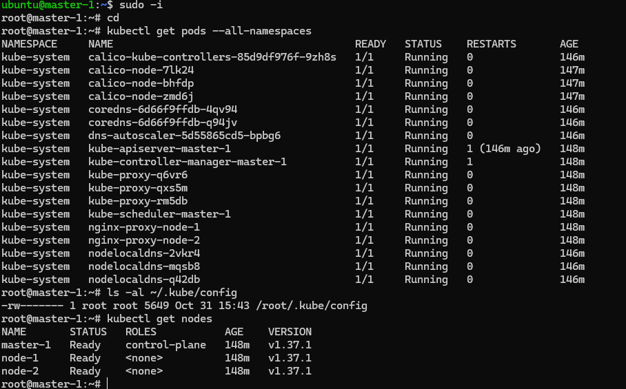
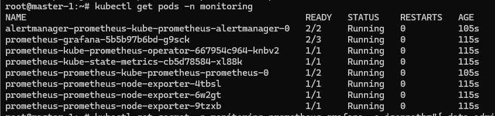
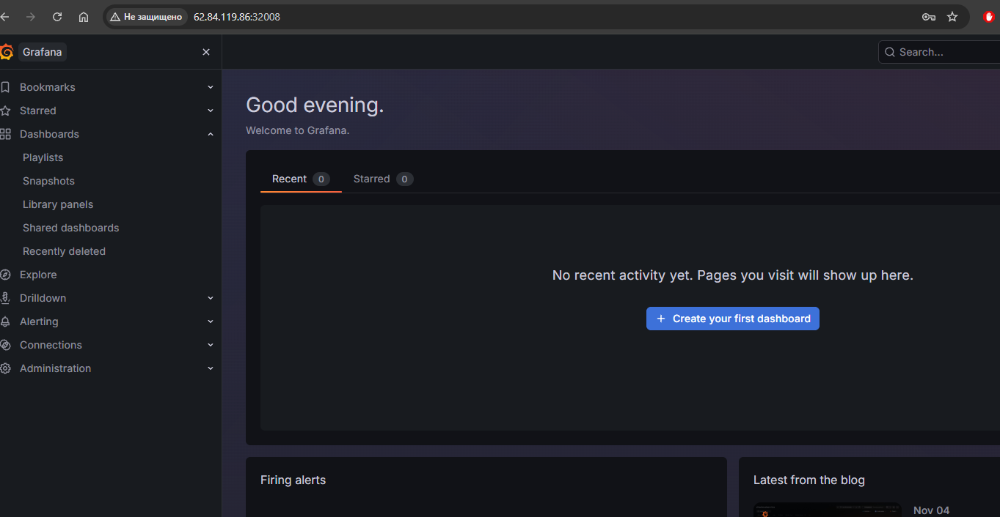
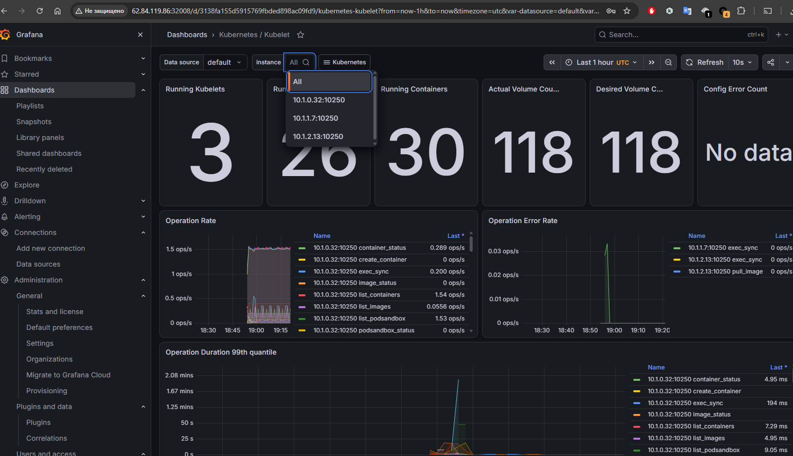
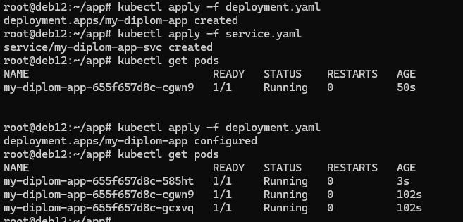
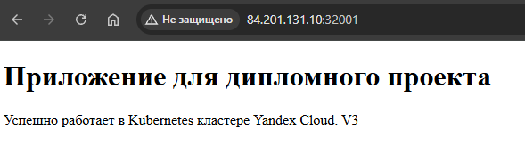
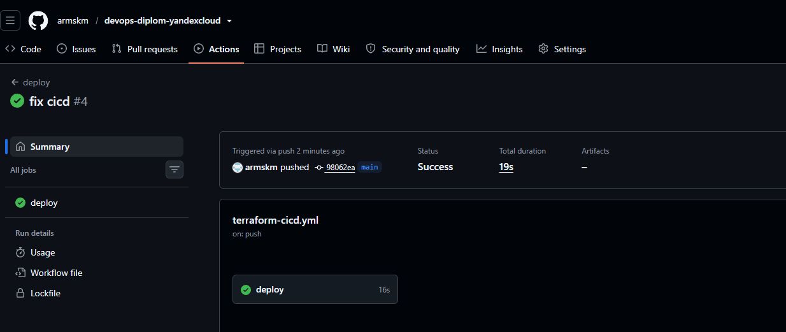
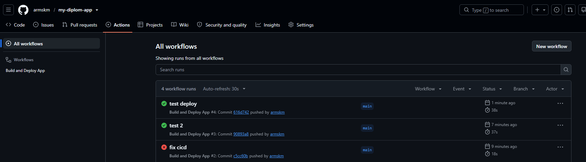
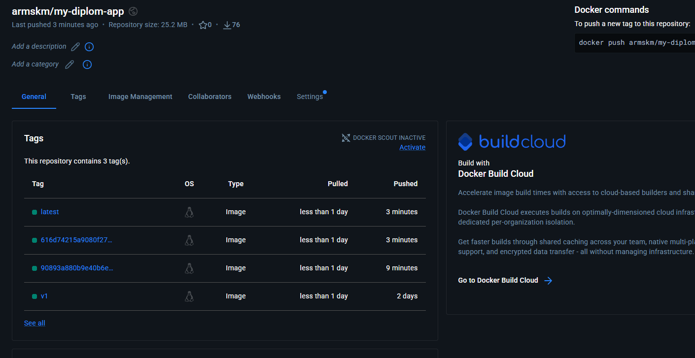

# Дипломный практикум в Yandex.Cloud

## Цели:

1. Подготовить облачную инфраструктуру на базе облачного провайдера Яндекс.Облако.
2. Запустить и сконфигурировать Kubernetes кластер.
3. Установить и настроить систему мониторинга.
4. Настроить и автоматизировать сборку тестового приложения с использованием Docker-контейнеров.
5. Настроить CI для автоматической сборки и тестирования.
6. Настроить CD для автоматического развёртывания приложения.


## Этапы выполнения:


### Создание облачной инфраструктуры

Предварительно создаю сервисную учетную запись и бакет s3 для хранения State terraform.
[Код в папке terraform-back](./terraform-back/)

Применяю:
```bash
terraform init
terraform apply
```
Через outputs получаю access_key и secret_key.
После создания бакета переношу state создания бакета в отдельную папку, изменив [providers.tf](./terraform-back/providers.tf) добавлением секции:
```bash
backend "s3" {
    endpoints                    = {
      s3 = "https://storage.yandexcloud.net"
    }
    bucket                      = "klementyev-bkt-2610"
    key                         = "back/terraform.tfstate"
    region                      = "ru-central1"
    access_key                  = <my access_key>
    secret_key                  = <my access_key>
    skip_region_validation      = true
    skip_credentials_validation = true
    skip_requesting_account_id  = true
    skip_s3_checksum            = true
  }
```
Переношу стейт:
```bash
terraform init
```



Создаю VPC с подсетями в разных зонах доступности. Код инфраструктуры создаю в отдельной папке [terraform-infra](./terraform-infra/)
[network.tf](./terraform-infra/network.tf)
В [providers.tf](./terraform-infra/providers.tf) так же указываю s3 для хранения state в папке infra.
После `terraform init` и `terraform apply` стейт хранится в s3 в отдельной папке infra.


Соответственно теперь при применении `terraform destroy` в папке terraform-infra стейт с хранением s3 не изменяется

### Создание Kubernetes кластера

Создаю инфраструктуру кластера Kubernetes в папке [terraform-infra](./terraform-infra/)

[Описание создание ВМ кластера](./terraform-infra/k8s.tf)

[Переменные](./terraform-infra/variables.tf)

[Файл генерации inventory для ansible](./terraform-infra/ansible_inventory.tf)

После создания vm с помощью ansible kubespray устанавливаю кластер Kubernetes
```bash
# настройка kubespray
git clone https://github.com/kubernetes-sigs/kubespray
cd kubespray
python3.12 -m venv .venv
.venv/bin/pip install --upgrade pip
.venv/bin/pip install -r requirements.txt
.venv/bin/ansible-playbook -u ubuntu -i /root/diplom/terraform-infra/ansible/inventory.ini cluster.yml -b -v
```

Получаю готовый кластер




### Создание тестового приложения

Приложение в отдельном проекте:

https://github.com/armskm/my-diplom-app

Простой файл index.html со статикой:
```bash
<!DOCTYPE html>
<html lang="ru">
<head><meta charset="utf-8"><title>Diplom App</title></head>
<body>
  <h1>Приложение для дипломного проекта</h1>
  <p>Успешно работает в Kubernetes кластере Yandex Cloud. V3</p>
</body>
</html>
```

И простой Dockerfile для сборки:

```bash
FROM nginx:alpine
COPY index.html /usr/share/nginx/html/index.html
EXPOSE 80
CMD ["nginx", "-g", "daemon off;"]
```
Готовый образ загрузил в регистр dockerhub

[https://hub.docker.com/repository/docker/armskm/my-diplom-app/general](https://hub.docker.com/r/armskm/my-diplom-app)


### Подготовка cистемы мониторинга и деплой приложения

Уже должны быть готовы конфигурации для автоматического создания облачной инфраструктуры и поднятия Kubernetes кластера.  
Теперь необходимо подготовить конфигурационные файлы для настройки нашего Kubernetes кластера.

Цель:
1. Задеплоить в кластер [prometheus](https://prometheus.io/), [grafana](https://grafana.com/), [alertmanager](https://github.com/prometheus/alertmanager), [экспортер](https://github.com/prometheus/node_exporter) основных метрик Kubernetes.

Выполним установку вышеуказанных мониторингов через `helm`. Сначала установим `helm` на `control-plane` ноду
```
curl https://raw.githubusercontent.com/helm/helm/master/scripts/get-helm-3 | bash
```
Создаем отдельное пространство имен для мониторинга
```
kubectl create namespace monitoring
```
Добавляем репозиторий `helm` c `prometheus`
```
helm repo add prometheus-community https://prometheus-community.github.io/helm-charts
```
Устанавливаем `kube-prometheus-stack` (установка `Prometheus`, `Grafana`, `Alertmanager`, `node-exporter` и `kube-state-metrics`)
```
helm install prometheus prometheus-community/kube-prometheus-stack -n monitoring
```
Проверяем, что все поры работают нормально
```
kubectl get pods -n monitoring
```


Получаем пароль от `Grafana`
```
kubectl get secret -n monitoring prometheus-grafana -o jsonpath="{.data.admin-password}" | base64 --decode ; echo
```
Настраиваем доступ к `Grafana` по внешнему ip адресу, для чего создаем файл values.yml
```yml
grafana:
  service:
    type: NodePort
    nodePort: 32008 
```
Обновляем `helm` чарт
```
helm upgrade prometheus prometheus-community/kube-prometheus-stack -n monitoring -f values.yml
```
http://62.84.119.86:32008/



Добавил пользователя guest с паролем guest.




Теперь нужно задеплоить тестовое приложение.

Манифесты [в папке app](./app/)

[deployment.yaml](./app/deployment.yaml)

[service.yaml](./app/service.yaml)

Применяю:

```bash
kubectl apply -f deployment.yml
kubectl apply -f service.yml
kubectl get pods
```






### Деплой инфраструктуры в terraform pipeline

Для применения terraform при пуше в ветку main воспользовался GitHub Actions. 

Добавил необходимые переменные в Actions текущего проекта.

Использовал self-hosted раннер.

CICD yml хранится в папке [.github/workflows](./.github/workflows)

[terraform-cicd.yml](./.github/workflows/terraform-cicd.yml)

При пуше изменений в ветку main происходит применение terraform.

https://github.com/armskm/devops-diplom-yandexcloud/actions




### Установка и настройка CI/CD

Так же воспользовался GitHub Actions в проекте https://github.com/armskm/my-diplom-app/tree/main

Настроил переменные и раннер.

CICD в файле: https://github.com/armskm/my-diplom-app/blob/main/.github/workflows/docker-cicd.yml

При изменении проекта происходит сборка образа, пуш image в DockerHub, деплой нового образа в кластер Kubernetes






